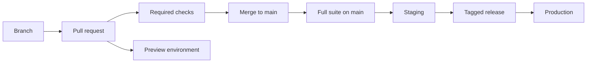

# 0028. Branching, CI and releases

| | |
|---|---|
| **Status** | Accepted |
| **Date** | 2026-10-11 |
| **Deciders** | Stuart Meeks |

## Context

Signboard is maintained part-time by one person, mostly with AI assistance, and will take outside contributions once there is code. Every change already goes through a pull request: `main` is protected, pull requests are squash-merged, and the **Docs** workflow's `build` and `journal` checks are required ([ADR 0014](0014-build-journal.md)). There is no code yet, so this is the moment to decide how code changes are tested, merged and released, before habits form.

The forces:

- `main` must stay trustworthy, because the hosted service and self-hosters both build from it.
- The testing rules in [ADR 0012](0012-testing.md) (real PostgreSQL, a 95% coverage gate, traceable acceptance criteria) need a pipeline that enforces them.
- Unfinished features must be able to merge without being switched on ([feature flags](0033-feature-flags.md)).
- Self-hosters need versioned releases they can pin, upgrade and roll back.
- The repository is public, so pull requests from forks must not be able to reach secrets.

## Decision

### Branching

- We will use **trunk-based development**. `main` is always releasable. All work happens on short-lived branches and comes back to `main` through a pull request. There is no `develop` branch and no long-lived release branch.
- Pull requests are **squash-merged**, so `main` has one commit per pull request and a linear history.
- Branches are named `type/short-description`, such as `feat/quote-versions` or `fix/gst-rounding`. This is a convention, not enforced.
- Unfinished work merges behind a **feature flag** ([ADR 0033](0033-feature-flags.md)), switched off in production until it is ready.
- If `main` breaks, fixing it comes before any other work: fix forward or revert the pull request.

### Pull request titles

Pull request titles follow **[Conventional Commits](https://www.conventionalcommits.org/)**: `type(scope): summary`, such as `feat(sales): add quote versions`, `fix(billing): round GST per line` or `docs: add ADR 0028`. Because pull requests are squash-merged, the title becomes the commit message on `main`. Types are `feat`, `fix`, `docs`, `test`, `refactor`, `perf`, `build`, `ci` and `chore`. A breaking change adds `!` after the type. Scopes, where used, are module names ([ADR 0026](0026-modular-monolith.md)). A required check enforces the format.

### Testing before merge

Testing happens on the pull request, before the merge. GitHub runs the checks against the branch as if it were already merged into `main`.

- **Locally**, developers run the same tests as CI. Testcontainers gives them the same PostgreSQL.
- **On every pull request**, the required checks below must pass before merge. Draft pull requests run them too, for early feedback.
- **Each pull request gets a preview environment**: the UI on its own URL, the API container and a throwaway database with seed data. It is where people try a feature and where exploratory checks with Claude in Chrome run ([ADR 0012](0012-testing.md)). It is torn down when the pull request closes. How it is built is decided with hosting.
- **After merge**, `main` runs the full suite again and deploys to staging.
- **Once there are other contributors**, we will turn on GitHub's merge queue, which tests pull requests in combination with each other before merging. Until then, the full run on `main` catches the rare case of two pull requests that pass separately but break together.

### Workflows and required checks

| Workflow | Runs on | Purpose |
|---|---|---|
| `Docs` | Every pull request; pushes to `main` | Build the docs site in strict mode, check the journal, publish the site (exists) |
| `CI` | Every pull request; pushes to `main`; nightly | Build, test and scan the code |
| `Release` | A version tag | Publish container images and the release notes |
| `Deploy` | Pushes to `main`; releases | Deploy to staging and production. Decided with hosting |

Each workflow filters by changed paths inside its jobs, not in its triggers, so every required check always reports a result.

The `CI` workflow's required checks on every pull request:

- **Pull request title:** Conventional Commits format.
- **Back end:** `dotnet build` with warnings treated as errors, a `dotnet format` check, and the unit, integration and architecture tests against PostgreSQL in Testcontainers.
- **Front end:** type-check, lint, format check, and Vitest.
- **Coverage:** the 95% line coverage gate, separately for the back end and the front end ([ADR 0012](0012-testing.md)).
- **API contract:** the OpenAPI document matches the code, the generated client is up to date, and breaking changes to a published API version fail the check unless the pull request is marked as breaking ([ADR 0020](0020-url-structure.md)).
- **End to end, smoke:** the Playwright journeys tagged `@smoke` (see below).
- **Security:** CodeQL, dependency review, and secret scanning with push protection.
- **Containers:** the API, worker and identity service images build. Images are only pushed on release.

### End-to-end tests

End-to-end tests are split into tiers from the start, rather than running everything everywhere until the suite gets slow and then splitting it:

| Tier | What | When | Blocks |
|---|---|---|---|
| Smoke | Playwright journeys tagged `@smoke`: sign-in and the core quote → sales order → job → invoice journey | Every pull request | The merge |
| Full | Every Playwright journey | Every push to `main`, nightly, and on request for a pull request (a `full-e2e` label) | A release; a failure on `main` is fixed before other work |

Every journey belongs to the full suite. A journey is tagged `@smoke` only if it covers a path that must never break and it runs quickly. The smoke tier has a time budget (five minutes to start with), and staying inside it is part of reviewing a new `@smoke` journey.

### Dependencies and supply chain

- **Dependabot** keeps NuGet, npm, GitHub Actions and Docker base images up to date. Minor and patch updates are grouped into one weekly pull request per ecosystem; major updates get their own. Security updates open immediately.
- Actions from outside GitHub's own `actions/` organisation are pinned to a full commit SHA, with the version in a comment. Dependabot keeps the pins current.
- Workflows triggered by pull requests use `pull_request`, never `pull_request_target`, so code from a fork never runs with secrets. Workflows ask for the least `permissions` they need.

### Reviews

- While there is one maintainer, every change still goes through a pull request and its required checks, but no approval is required, and the maintainer, or an AI assistant acting for the maintainer, may admin-merge.
- When contributors arrive, we will add a `CODEOWNERS` file and require one approval from a code owner.

### Releases

- Releases use **semantic versioning** from the first deployable build: `vMAJOR.MINOR.PATCH`. Before 1.0, a minor version may contain breaking changes.
- **release-please** reads the Conventional Commits titles on `main` and keeps a release pull request open with the next version number and the changelog. Merging that pull request tags the release.
- A tag runs the `Release` workflow, which publishes the container images to GitHub Container Registry, tagged with the version, and attaches the release notes. Self-hosters pin a version rather than following `main`.
- A release is only tagged from a commit whose full `CI` run, including the full end-to-end suite, has passed.
- `main` deploys to staging automatically, and production runs tagged releases. The details are decided with hosting.

### Follow-up decisions

- **Feature flags:** decided in [ADR 0033](0033-feature-flags.md).
- **Hosting:** how preview environments, staging and production deployments are built.

## Options considered

### Branching

1. **Trunk-based development with short-lived branches and squash merge**: simple, keeps `main` releasable, suits one maintainer and later contributors, and pairs naturally with feature flags and preview environments. **Chosen.**
2. **GitFlow** (`develop`, release and hotfix branches): suits scheduled releases of installed software; adds merges between long-lived branches, delays integration, and duplicates what pull requests and preview environments already give us.
3. **GitHub flow with merge commits**: the same as the chosen option, but with a noisier history and no single commit per change to revert or read.

### End-to-end tests

1. **Smoke subset on pull requests, full suite on `main`, nightly and before release, from the start**: fast pull requests, the full suite still guards every release, and the split never has to be retrofitted. **Chosen.**
2. **Full suite on every pull request until it gets slow, then split**: the strongest gate while the suite is small; in practice the split is put off and pull requests get slower and flakier.
3. **End-to-end tests nightly only**: fastest pull requests; breakages reach `main` with nothing to stop them.

### Dependency updates

1. **Dependabot**: built into GitHub, no setup beyond a config file, supports grouping. **Chosen.**
2. **Renovate**: more configurable (scheduling, auto-merge rules, monorepo grouping); another app to install and configure.

### Versioning

1. **Semantic versions from the first deployable build, automated by release-please**: self-hosters can pin and roll back; the changelog writes itself from pull request titles. **Chosen.**
2. **Continuous deployment with no versions until self-hosters ask**: less ceremony now; retrofitting versions and a changelog later is harder than starting with them.

## Consequences

- Pull request titles need a little discipline, enforced by a check. In return the changelog and version numbers are automatic.
- A change that breaks a journey outside the smoke tier can reach `main`. The full suite on `main` catches it within one run, and it blocks the next release, but it has to be fixed straight away. Risky changes can run the full suite before merge with the `full-e2e` label.
- [ADR 0012](0012-testing.md) said all automated tests run on every pull request. It now says end-to-end tests run in the tiers above.
- Preview environments cost money and need hosting decided first. Until then, exploratory checks run locally.
- The `CI`, `Release` and Dependabot configuration are written with the first code, and their checks are added to the `main` ruleset then.
- Pinning third-party actions by SHA means more Dependabot pull requests, which are grouped to keep the noise down.
- This decision itself starts now: pull request titles follow Conventional Commits from this ADR onwards, and the title check is added with the `CI` workflow.
