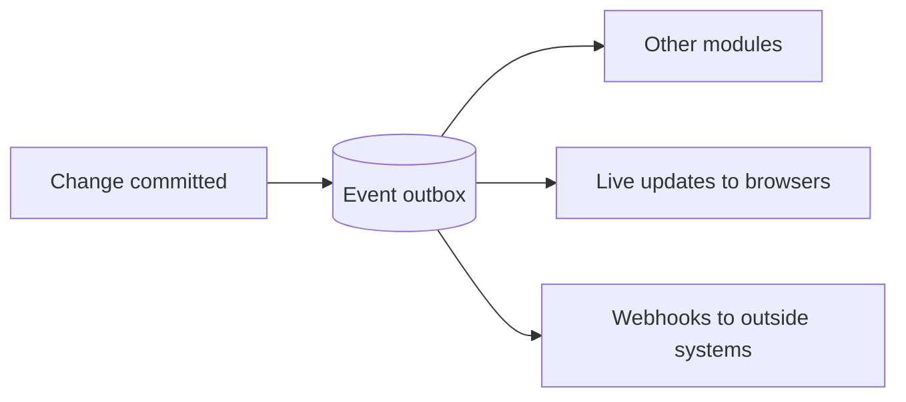

# 0032. Events, webhooks and live updates

| | |
|---|---|
| **Status** | Accepted |
| **Date** | 2026-10-11 |
| **Deciders** | Stuart Meeks |

## Context

Several people work in Signboard at the same time, often on the same objects: the office, the designers, the shop floor on a tablet, and customers in the portal. If the screen only changes when someone presses refresh, people act on stale information. A job moved on the board, a quote accepted by the customer, or an invoice paid should appear for everyone straight away, and not only on the kanban board: every grid, every detail page, every count and badge.

Three other needs are close to this one:

- **Modules react to each other.** When a quote is accepted, production needs to know. Modules must not reach into each other's tables ([ADR 0026](0026-modular-monolith.md)), and some reactions belong outside the original transaction, such as notifying people or syncing to accounting.
- **Integrations need to hear about changes** without polling the API. API first ([ADR 0010](0010-api-first.md)) means they get the same information the web app does.
- **The data must stay protected.** Whatever reaches a browser or a webhook must respect the same record and field visibility as the API ([ADR 0010](0010-api-first.md), [ADR 0022](0022-authorisation-and-roles.md)).

Every object already has a revision incremented by a database trigger on every change ([ADR 0031](0031-concurrency.md)), so there is one place where every change can be seen.

## Decision

We will have **one event system with three consumers**: other modules, live updates to browsers, and webhooks to outside systems. Every change produces an event in the same database transaction as the change itself.

### Events

There are two kinds of event:

- **Change events, for every object, automatically.** The revision trigger ([ADR 0031](0031-concurrency.md)) also writes a row to the event outbox whenever an object is created, updated or deleted: the object's type, ID and new revision, the kind of change, the business, the acting user or credential, and the trace ID ([ADR 0025](0025-observability.md)). No code can forget to raise one, and no code path can skip it.
- **Business events, named and raised by application code** in the same transaction as the change, for things a field change does not express: `sales.quote.sent`, `sales.quote.accepted`, `production.job.moved`, `billing.invoice.paid`. Each business event names the object it concerns and may carry a small, documented set of fields.

Rules:

- Event types are named `{module}.{object}.{verb}`, using the API's module names ([ADR 0020](0020-url-structure.md)). Change events use the verbs `created`, `updated` and `deleted`, such as `sales.quote.updated`.
- Every event has its own ID with the prefix `EVT` ([ADR 0017](0017-object-ids.md)), and records when it happened.
- The outbox is a PostgreSQL table, partitioned by day, with row-level security like every tenant-owned table ([ADR 0004](0004-multi-tenant.md)). A new event wakes the dispatcher immediately with `LISTEN/NOTIFY`; the dispatcher also polls, so nothing is missed if a notification is lost.
- Delivery to every consumer is **at least once**. Every consumer must cope with the same event twice, and uses the object's revision to ignore anything older than what it already has.
- Events are kept for **7 days**, which covers live-update replay and webhook retries, then hard-deleted as short-lived technical data ([ADR 0018](0018-soft-delete.md)).
- Events are not the audit trail. The audit trail ([ADR 0019](0019-audit-trail.md)) is the permanent history of every change. Events are short-lived notices that something happened.
- The background worker runs event handlers and webhook deliveries on its job queue ([ADR 0034](0034-background-work.md)).

### Between modules

- A module subscribes to another module's business events through that module's public interface ([ADR 0026](0026-modular-monolith.md)). Handlers run in the background worker, after the original transaction has committed, and must be idempotent.
- Work that must succeed or fail together with the original change stays in one transaction, coordinated through module interfaces, as [ADR 0026](0026-modular-monolith.md) already says. Events are for what can happen afterwards.

### Live updates

**Transport: Server-Sent Events (SSE)**, using ASP.NET Core's built-in support in .NET 10, subject to a spike through CloudFront (below).

- The web app opens one stream per tab at `GET /api/v1/system/events/stream`, through the same origin and with the same session cookie as every other API call ([ADR 0015](0015-separate-deployments-one-origin.md)).
- The stream is **one-way**. All changes still go through the REST API, so there is no second API to secure.
- The stream is part of the **public API**, documented in the API reference. Integrations may read it with an API token.
- **Notifications are thin.** Each one says only what changed: the event type, the object's type, ID and new revision, and who made the change. **No object data is ever pushed.** The client fetches the object through the normal API, so record and field visibility are enforced in one place only.
- **Each subscriber hears only about what it can see.** Every notification is filtered by the same visibility policy that governs the API, per membership. A customer user never learns that an object they cannot see exists, not even its ID.
- **Every API task serves streams.** Each task listens to the event feed and pushes to its own connections, so no message broker or backplane is needed.
- The server sends a **heartbeat** comment every 15 seconds, below CloudFront's 30-second origin response timeout.
- **Reconnection and replay.** The browser reconnects automatically and sends the last event ID it received (`Last-Event-ID`). The server replays what that subscriber missed, from the outbox. If the gap is older than the outbox keeps, the server says so and the client refetches what is on screen.

**What the UI does with a notification** (detailed in the [front-end design](../design/front-end.md)):

| Where | Behaviour |
|---|---|
| Every grid (`DataGrid`) | After a short pause to batch changes, the visible page refetches in place, keeping scroll position and selection. Changed rows highlight briefly |
| A detail page being viewed | Refetches silently |
| A form being edited | Nothing changes under the user. A banner says who changed the object and offers to review the changes, before the user saves rather than after ([ADR 0031](0031-concurrency.md)) |
| Kanban board | Cards move as other people move them, with a short animation |
| Counts, badges and in-app notifications | Update as notifications arrive |
| The user's own changes | Ignored when the UI already holds that revision, so nothing echoes back |

Each tab has its own stream to start with. Sharing one stream between a user's tabs is a later optimisation.

### The CloudFront spike

Before live updates are built, a short spike confirms SSE works through the production path: browser → CloudFront → VPC origin → internal load balancer → API task ([ADR 0030](0030-hosting-aws.md)). It passes if:

- a stream stays open for at least an hour with heartbeats, without being cut or buffered;
- notifications arrive within about a second of the change;
- reconnection with `Last-Event-ID` replays missed events, including after a deploy replaces the API task;
- many tabs over HTTP/2 work without hitting connection limits.

If it fails, we fall back to WebSockets, which CloudFront supports, through SignalR or a thin layer of our own. That change would be recorded by updating this ADR. Everything else here, including thin notifications, visibility filtering and replay from the outbox, stays the same.

This comparison informed the choice, and is kept here for the spike:

| | SSE | SignalR |
|---|---|---|
| Direction | Server to browser only, which is all we need: changes go through the REST API | Both ways. A two-way channel invites commands outside the API, against [ADR 0010](0010-api-first.md) |
| Protocol | Plain HTTP and a W3C standard. Any HTTP client in any language can read it | Microsoft's protocol over WebSockets. Integrators need a SignalR client: official clients exist for .NET, JavaScript and Java; most other languages rely on community libraries |
| As a public API | Another documented endpoint | Awkward to offer to integrators |
| Catching up after a disconnect | Built into the standard: the browser reconnects and sends `Last-Event-ID`, and the server replays from the outbox | Reconnects automatically but has no replay. We would build it |
| Several API tasks | Each task listens to the event feed and pushes to its own connections | The same, or a Redis backplane. Sticky sessions are needed unless it is restricted to WebSockets only |
| .NET support | Built into .NET 10 (`TypedResults.ServerSentEvents`) | Mature and built in |
| Browser bundle | Nothing extra: `EventSource` is built into browsers | Adds a client library |
| Awkward networks | Usually fine over HTTPS; some proxies buffer streams | Better: falls back from WebSockets to SSE to long polling automatically |
| Through CloudFront | **Not proven.** CloudFront closes an origin connection after a gap with no data (30 seconds by default), hence the heartbeat. We found no AWS documentation confirming that CloudFront does not buffer `text/event-stream` responses | **Documented.** CloudFront supports WebSockets |
| Many tabs | Fine over HTTP/2, which CloudFront uses: many streams share one connection | Fine |

SignalR would win if the browser needed to send messages through the live channel, such as for chat or shared cursors, or if CloudFront turns out to break SSE.

### Webhooks

- Webhooks are objects (prefix `WHK`), created and managed through the API at `/api/v1/system/webhooks`: an HTTPS URL, the event types to receive, and a signing secret.
- **At launch, only business accounts can create webhooks**: business administrators, and API tokens with the right permission ([ADR 0022](0022-authorisation-and-roles.md)). Customer accounts may get them later.
- A webhook belongs to the membership or API token that created it, and receives only events about objects that actor can see.
- **Signing and headers follow the [Standard Webhooks](https://www.standardwebhooks.com/) specification**: `webhook-id` (the event ID), `webhook-timestamp` and `webhook-signature` (HMAC-SHA256). Receivers can verify signatures with the specification's libraries, and should reject old timestamps to prevent replays.
- **The payload is the event plus the object** as the webhook's owner would see it at the time of the event, with hidden fields omitted ([ADR 0010](0010-api-first.md)) and its `revision` included ([ADR 0031](0031-concurrency.md)). Receivers use `webhook-id` to discard duplicates and `revision` to discard anything older than what they hold.
- **Delivery.** A delivery succeeds on any `2xx` response within 10 seconds. Failures are retried with growing intervals for about **3 days**. A webhook whose deliveries keep failing is switched off, and the business's administrators are emailed ([ADR 0023](0023-email-sending.md)).
- **Visibility.** Each webhook has a delivery log in the API for 30 days (status, response code and timing), a redeliver action, and a test action that sends a ping.
- **Protection against misuse.** Webhook URLs must use HTTPS. Requests to private, loopback and link-local addresses, and to cloud metadata addresses, are refused. The destination's DNS is checked at send time, not only when the webhook is created, and redirects are not followed. Webhook deliveries leave from the worker, never from an API request.
- **Contract.** Payloads are described in the OpenAPI contract's `webhooks` section, and a webhook keeps the API version it was created under ([ADR 0029](0029-api-errors-idempotency-versioning.md)).

## Options considered

### Where events come from

1. **Change events from the revision trigger, plus named business events from code, through one transactional outbox**: every change is covered with no code to forget, business meaning is explicit, and events commit or roll back with the change. **Chosen.**
2. **Events raised only by application code**: explicit; a forgotten event means a screen that silently stops updating, and bulk updates are missed.
3. **Reading PostgreSQL's write-ahead log** (logical replication or a change data capture tool): sees every change without triggers; another moving part to run and monitor, and table-level changes still need turning into object-level events.
4. **A message broker** (such as RabbitMQ or Amazon SQS and SNS): standard for distributed systems; another service to run, and publishing to it cannot share a transaction with the database without an outbox anyway.

### What is pushed to browsers

1. **Thin notifications, then a normal API fetch**: visibility enforced in one place, small messages, and the client's cache stays the single source of truth. **Chosen.**
2. **Pushing object data**: saves a request per change; the field visibility logic would have to be repeated in the push channel and kept in step with the API forever.

### Transport

1. **Server-Sent Events**, subject to the spike. **Chosen.** See the comparison above.
2. **SignalR (WebSockets with fallbacks)**: the fallback if the spike fails.
3. **Polling**: simplest and works anywhere; slow to show changes, and wasteful across every grid and page.

### Webhook signing

1. **Standard Webhooks**: an open specification with libraries in most languages, so receivers need no custom code. **Chosen.**
2. **Our own signature scheme**: no advantage, and every receiver writes custom verification code.

## Consequences

- The revision trigger in [ADR 0031](0031-concurrency.md) also writes to the outbox, so every aggregate root table gets live updates and change events without further work.
- The outbox needs a dispatcher in the worker, a feed that API tasks listen to, and monitoring of its backlog ([ADR 0025](0025-observability.md)).
- Visibility filtering for notifications must be fast, because it runs for every event and every connected user. It uses the same policy code as the API, with each membership's visibility cached while its stream is open.
- Every API task holds long-lived connections. The load balancer's idle timeout and the API's connection limits are set for this in the deployment design.
- Every event type, business event field and webhook payload is documented in the API reference, and adding one is part of the feature's design doc.
- The front-end design doc defines how notifications invalidate TanStack Query caches, the editing banner and the kanban animation.
- `EVT` and `WHK` are added to the prefix register in the data model.
- The CloudFront spike happens before live updates are built, and its result is recorded here.
