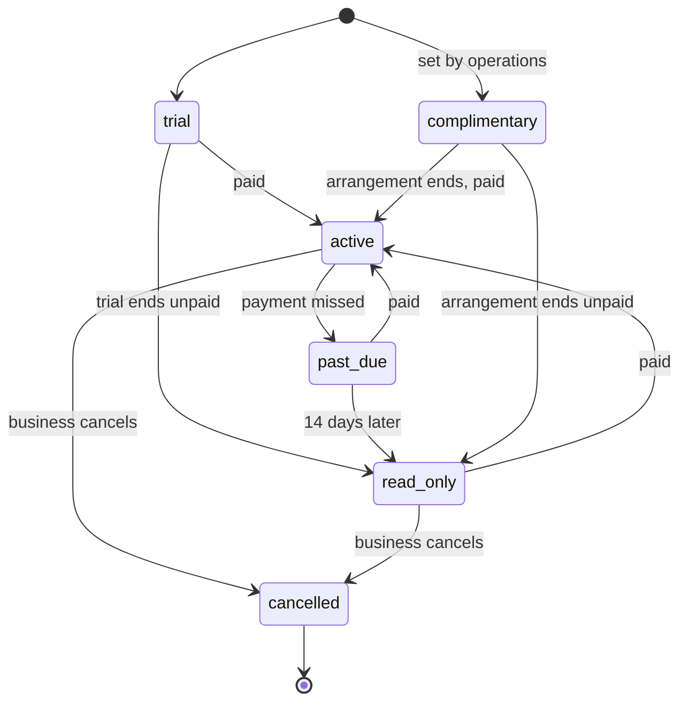

# 0047. Sign-up, plans and billing

| | |
|---|---|
| **Status** | Proposed |
| **Date** | 2026-10-11 |
| **Deciders** | Stuart Meeks |

> **Draft for review.** Written from Claude's recommendations. The choices still open are listed under [Questions for review](#questions-for-review).

## Context

Most shops would rather sign up for Signboard than run it ([ADR 0004](0004-multi-tenant.md)). The hosted service costs about A$340 a month to run at launch ([ADR 0030](0030-hosting-aws.md), [ADR 0039](0039-security-baseline.md)), and Signboard is not a money-making exercise ([ADR 0003](0003-licence.md)): what businesses pay should cover the running costs, with as little cost and effort spent on collecting it as possible.

Already decided:

- **Editions apply only to the hosted service.** A self-hosted installation gets every feature, and the whole product is open source, with no open core.
- **How features are switched on or off per plan** is the entitlement mechanism in [ADR 0046](0046-entitlements.md). This ADR decides the plans, how a business signs up, and how it pays.
- The `billing` module ([ADR 0020](0020-url-structure.md)) holds a business's own invoices to its customers. Signboard charging businesses for the hosted service is a different thing, and must not be confused with it.

Payment options, as published on 2026-10-11:

| Option | Cost to Signboard | Source |
|---|---|---|
| Invoices raised by hand, paid by bank transfer | No per-payment fees | — |
| Stripe Billing, with cards | 1.65% + A$0.30 per domestic card payment, 3.5% + A$0.30 for international cards, plus Billing at 0.7% of billed volume | [Stripe Australia pricing](https://stripe.com/au/pricing) |
| Paddle, as merchant of record | 5% + 50¢ per transaction | [Paddle pricing](https://www.paddle.com/pricing) |
| Lemon Squeezy, as merchant of record | 5% + 50¢ per transaction, plus 0.5% for subscription payments and 1.5% for payments from outside the United States | [Lemon Squeezy fees](https://docs.lemonsqueezy.com/help/getting-started/fees) |

On a A$50 monthly subscription, Stripe would cost about A$1.48 (3%) Paddle about A$3.00 (6%), and Lemon Squeezy about A$4.00 (8%), before currency conversion.

On tax: a business must register for GST once its GST turnover reaches A$75,000 a year, and needs an ABN to register; below that, registration is optional ([ATO: registering for GST](https://www.ato.gov.au/businesses-and-organisations/gst-excise-and-indirect-taxes/gst/registering-for-gst)). The hosted service's revenue is expected to stay below the threshold for some time. This is not tax advice: the operator of the hosted service confirms its GST treatment with an accountant.

## Decision

### Plans

- **One paid plan at launch**, called Standard, with every feature. Its price is set to cover running costs, and is a question for review.
- **No free plan.** A free plan on the hosted service costs real money for every business on it. The free option is self-hosting, which gets everything.
- **A 30-day trial** of the full plan, with no payment details needed.
- **Complimentary** status, set by an operations user, for businesses that should not pay, such as an open-source project or a charity. Each complimentary arrangement has a reason and an optional end date, and is audited ([ADR 0019](0019-audit-trail.md)).
- More plans can be added later without code changes to features, because features are gated by entitlements ([ADR 0046](0046-entitlements.md)), never by plan names.

### Signing up

A business signs itself up, without anyone at Signboard involved:

1. The person signs in, or creates their user, through the identity service, with a verified email address ([ADR 0021](0021-authentication.md)). As the business's first administrator, they must set up a passkey or a second factor.
2. They name the business and choose its subdomain, `<business>.signboard.works`, under the rules in [ADR 0020](0020-url-structure.md): lowercase letters, digits and hyphens, unique, and never a reserved name. The form suggests one from the business name and checks it as they type.
3. They choose the business's **country**, which suggests its currency, tax rates, time zone and locale ([ADR 0036](0036-money-tax-and-time.md), [ADR 0037](0037-localisation.md)). They can change any of them before finishing.
4. They accept the terms of service and privacy policy. The version and time are recorded.
5. The business account is created with them as its administrator, the trial starts, and they arrive at their business's address.

Sign-up is protected by the limits in [ADR 0038](0038-rate-limiting.md), and by CAPTCHA only if it is abused ([ADR 0042](0042-accessibility.md#sign-in)). A subdomain, once used, is never given to another business, even after the first business is deleted, so old links and emails can never lead to someone else's data.

Self-hosted installations have no sign-up, plans or trial: the first run creates the one business, and every feature is on.

### Subscription status

Each business account has a subscription, kept in the `accounts` module with the business account it belongs to ([ADR 0020](0020-url-structure.md)). It is platform-level data, outside any tenant ([ADR 0004](0004-multi-tenant.md)).

The subscription records whether and how the business pays. Which features it gets is its edition assignment ([ADR 0046](0046-entitlements.md)), which the subscription sets: a trial is an assignment of Standard that ends with the trial, and `read_only` applies to the whole account, not to one feature. A read-only business keeps its last edition assignment for reading and export, so it can still see and take out everything; a write that passes the feature-flag and permission checks is refused with `403 account_read_only`, before entitlements are checked ([ADR 0046](0046-entitlements.md#evaluation)).

- **Business administrators** see their plan, status and paid-until date, and receive email reminders before a trial ends, when a payment is missed, and before read-only starts ([ADR 0023](0023-email-sending.md)).
- **Read-only** means the business's people can still sign in, see and export everything ([ADR 0051](0051-data-export-and-leaving.md)), and its customers can still see what was sent to them, but nothing can be created or changed. Changes are refused with `403`, code `account_read_only`.
- **Nothing is deleted for non-payment.** Data is deleted only after a business cancels, and then only as [ADR 0051](0051-data-export-and-leaving.md) sets out, after notice and a chance to export.

### Paying, at launch

- **Invoices raised by hand, paid by bank transfer.** The operator of the hosted service invoices each paying business monthly or yearly from its own accounting, and an operations user records the payment and paid-until date in the operations app. There are no payment fees and nothing to build beyond the subscription status.
- This suits a handful of businesses. When manual invoicing takes too long, or businesses ask to pay by card, billing moves to Stripe.

### Paying, later

- **Stripe Billing** with Stripe's hosted Checkout and Customer Portal. Card details are entered only on Stripe's pages and never reach Signboard, which keeps Signboard to the simplest PCI DSS self-assessment (SAQ A).
- Stripe's events arrive as signed webhooks, are processed as background jobs ([ADR 0034](0034-background-work.md)), and update the subscription status. The status, not Stripe, is what the rest of Signboard reads.
- **Not a merchant of record.** Paddle and Lemon Squeezy would handle tax in every country for us, but at about twice Stripe's cost, and selling mostly to Australian businesses does not need it. This is revisited if Signboard sells widely abroad.

### Tax on subscriptions

- Prices are shown and invoiced in Australian dollars at launch.
- If the operator is registered for GST, subscription invoices are tax invoices that show GST; if not, they do not charge GST. Signboard supports both, and the operator decides with an accountant.

## Options considered

### Plans

1. **One paid plan, a trial and complimentary status**: simplest to explain and build; covers costs. **Chosen.**
2. **A free plan with limits, and a paid plan**: lowers the barrier to trying it; every free business adds hosting cost with no revenue, and the self-hosted edition is already free.
3. **Several editions from launch**: more choice; nobody yet knows which features belong in which.

### Payment

1. **Manual invoicing at launch, Stripe Billing later**: no fees and nothing to build for the first businesses, with a clear path to automation. **Chosen.**
2. **Stripe Billing from the first business**: automated from day one; a build and about 3% of revenue before it saves any time.
3. **A merchant of record (Paddle or Lemon Squeezy)**: handles tax everywhere; about 6% of revenue, and unnecessary while customers are mostly Australian.

### Where subscriptions live

1. **In `accounts`, with the business account**: the subscription describes the account, and stays clear of the business's own `billing` module. **Chosen.**
2. **In `billing`**: the obvious name; mixes Signboard charging businesses with businesses charging their customers.

## Consequences

- Subscriptions are new objects, and need an ID prefix registered in the [data model](../design/data-model.md).
- `account_read_only` is a new error code ([ADR 0029](0029-api-errors-idempotency-versioning.md)).
- The operations app needs subscription views: trials ending, payments due, complimentary arrangements.
- Terms of service and a privacy policy must exist before the first sign-up. The privacy policy follows [ADR 0044](0044-privacy-and-data-residency.md).
- Moving to Stripe later is a design doc and a feature behind a flag ([ADR 0033](0033-feature-flags.md)), not a change to this decision.
- A sign-up PRD is needed, with its stories, before the sign-up screens are built.

## Questions for review

1. **No free plan**, with self-hosting as the free option and a 30-day trial without payment details. Or a free plan with limits?
2. **One plan, Standard, at launch.** Or several editions from the start?
3. **The price.** Lean: a monthly price, with a yearly option at a discount, set so that about ten paying businesses cover the running costs. What price does Stuart have in mind?
4. **Manual invoicing and bank transfer at launch**, moving to Stripe Billing when it gets too slow or businesses ask for cards. Or Stripe from the first paying business?
5. **No merchant of record**, accepting that Signboard's operator handles its own tax. Or Paddle, at about twice the cost, for simplicity abroad?
6. **Grace and read-only.** 14 days past due, then read-only, never deletion for non-payment. Are the lengths right?
7. **Subscriptions in the `accounts` module**, managed by operations users at launch. Or a module of their own?
8. **Who operates the hosted service** for invoicing and GST: Stuart as a sole trader, or a separate entity? This decides whose ABN appears on invoices, and is a question for an accountant.
