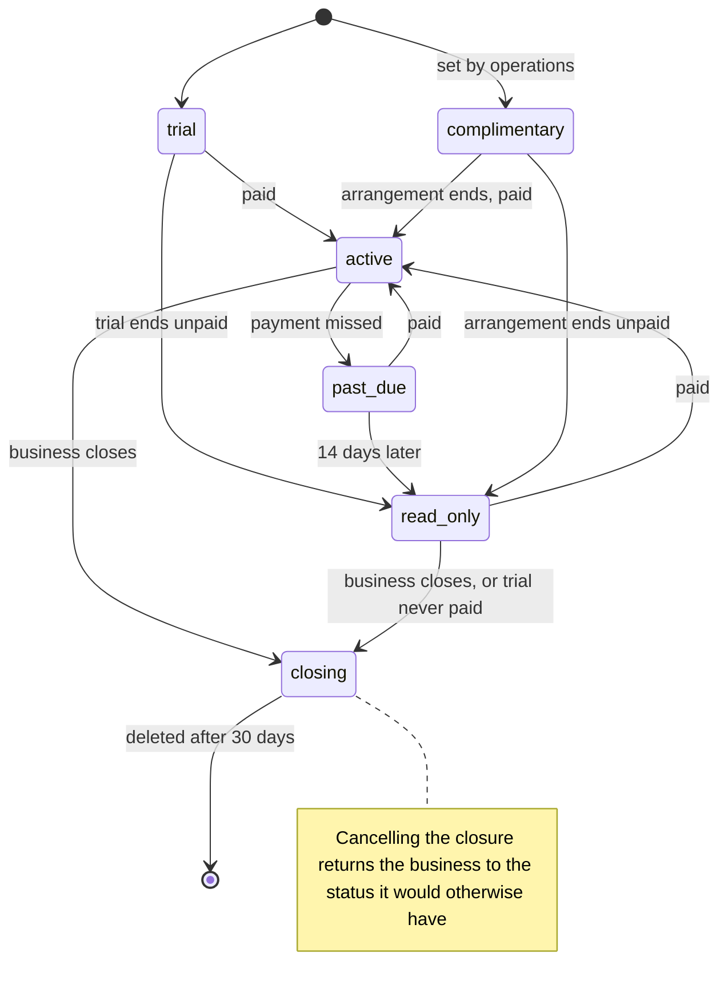

# 0047. Sign-up, plans and billing

| | |
|---|---|
| **Status** | Accepted |
| **Date** | 2026-10-12 |
| **Deciders** | Stuart Meeks |

## Context

Most businesses would rather sign up for Signboard than run it ([ADR 0004](0004-multi-tenant.md)). The hosted service costs about A$345 a month to run at launch, and about A$500 once it is ready for paying businesses ([ADR 0030](0030-hosting-aws.md), [ADR 0039](0039-security-baseline.md), [ADR 0043](0043-backups-and-recovery.md), [ADR 0048](0048-documents-and-templates.md)), and Signboard is not a money-making exercise ([ADR 0003](0003-licence.md)): what businesses pay should cover the running costs, with as little cost and effort spent on collecting it as possible.

Already decided:

- **Editions apply only to the hosted service.** A self-hosted installation gets every feature, and the whole product is open source, with no open core.
- **How features are switched on or off per plan** is the entitlement mechanism in [ADR 0046](0046-entitlements.md). This ADR decides the plans, how a business signs up, and how it pays.
- The `billing` module ([ADR 0020](0020-url-structure.md)) holds a business's own invoices to its customers. Signboard charging businesses for the hosted service is a different thing, and must not be confused with it.

Payment options, as published on 2026-10-11:

| Option | Cost to Signboard | Source |
|---|---|---|
| Invoices raised by hand, paid by bank transfer | No per-payment fees | — |
| Stripe Billing, with cards | 1.65% + A$0.30 per domestic card payment, 3.5% + A$0.30 for international cards, plus Billing at 0.7% of billed volume | [Stripe Australia pricing](https://stripe.com/au/pricing) |
| Paddle, as merchant of record | 5% + 50¢ per transaction | [Paddle pricing](https://www.paddle.com/pricing) |
| Lemon Squeezy, as merchant of record | 5% + 50¢ per transaction, plus 0.5% for subscription payments and 1.5% for payments from outside the United States | [Lemon Squeezy fees](https://docs.lemonsqueezy.com/help/getting-started/fees) |

On a A$50 monthly subscription, Stripe would cost about A$1.48 (3%) Paddle about A$3.00 (6%), and Lemon Squeezy about A$4.00 (8%), before currency conversion.

On tax: a business must register for GST once its GST turnover reaches A$75,000 a year, and needs an ABN to register; below that, registration is optional ([ATO: registering for GST](https://www.ato.gov.au/businesses-and-organisations/gst-excise-and-indirect-taxes/gst/registering-for-gst)). The hosted service's revenue is expected to stay below the threshold for some time. This is not tax advice: the operator of the hosted service confirms its GST treatment with an accountant.

## Decision

### Plans

- **One paid plan at launch**, called Standard, with every feature.
- **One price per business, with unlimited users**: **A$49 a month, or A$490 a year** (two months free), including GST if the operator charges it. Charging per user would work against the vision, which counts per-seat pricing among the problems with the tools businesses use today. About eleven businesses paying monthly, or thirteen paying yearly, cover the running costs. The price is reviewed against costs as the service grows.
- **No free plan.** A free plan on the hosted service costs real money for every business on it. The free option is self-hosting, which gets everything.
- **A 30-day trial** of the full plan, with no payment details needed.
- **Complimentary** status, set by an operations user, for businesses that should not pay, such as an open-source project or a charity. Each complimentary arrangement has a reason and an optional end date, and is audited ([ADR 0019](0019-audit-trail.md)).
- More plans can be added later without code changes to features, because features are gated by entitlements ([ADR 0046](0046-entitlements.md)), never by plan names.

### Signing up

A business signs itself up, without anyone at Signboard involved:

1. The person signs in, or creates their user, through the identity service, with a verified email address ([ADR 0021](0021-authentication.md)). As the business's first administrator, they must set up a passkey or a second factor.
2. They name the business and choose its subdomain, `<business>.signboard.works`, under the rules in [ADR 0020](0020-url-structure.md): lowercase letters, digits and hyphens, unique, and never a reserved name. The form suggests one from the business name and checks it as they type.
3. They choose the business's **country**, which suggests its currency, tax rates, time zone and locale ([ADR 0036](0036-money-tax-and-time.md), [ADR 0037](0037-localisation.md)). They can change any of them before finishing.
4. They accept the terms of service and privacy policy. The version and time are recorded.
5. The business account is created with them as its administrator, the trial starts, and they arrive at their business's address.

Sign-up is protected by the limits in [ADR 0038](0038-rate-limiting.md), and by CAPTCHA only if it is abused ([ADR 0042](0042-accessibility.md#sign-in)). A subdomain, once used, is never given to another business, even after the first business is deleted, so old links and emails can never lead to someone else's data.

Self-hosted installations have no sign-up, plans or trial: the first run creates the one business, and every feature is on.

### Subscription status

Each business account has a subscription, kept in the `accounts` module with the business account it belongs to ([ADR 0020](0020-url-structure.md)). It is platform-level data, outside any tenant ([ADR 0004](0004-multi-tenant.md)).

The subscription records whether and how the business pays. Which features it gets is its edition assignment ([ADR 0046](0046-entitlements.md)), which the subscription sets: a trial is an assignment of Standard that ends with the trial, and `read_only` applies to the whole account, not to one feature. A read-only business keeps its last edition assignment for reading and export, so it can still see and take out everything; a write that passes the feature-flag and permission checks is refused with `403 account_read_only`, before entitlements are checked ([ADR 0046](0046-entitlements.md#evaluation)).

- **Past due** lasts 14 days. Administrators are emailed when the payment is missed, 7 days later, and the day before read-only starts ([ADR 0023](0023-email-sending.md)).
- **Business administrators** see their plan, status and paid-until date, and are also emailed before a trial ends.
- **Closing** is the closure in [ADR 0051](0051-data-export-and-leaving.md#a-business-leaving): read-only for 30 days, with export, reminders and the option to cancel, then deletion. Cancelling the closure returns the business to the status it would otherwise have: its trial if the trial has not ended, active if it is paid up, and read-only otherwise. An administrator can close the business from any status; the diagram shows the usual cases.
- **Read-only** means the business's people can still sign in, see and export everything ([ADR 0051](0051-data-export-and-leaving.md)), and its customers can still see what was sent to them, but nothing can be created or changed. Changes are refused with `403`, code `account_read_only`.
- **A business that has paid is never deleted for non-payment.** It stays read-only, with everything visible and exportable, until it pays or closes.
- **A trial that is never paid for is closed.** A business that has never paid, and is not complimentary, starts closing 90 days after its trial ends, after its administrators are emailed 14 days and 1 day beforehand. It then has the usual 30 days of closure, with export. Without this, every abandoned trial would be kept, and paid for, for ever.

### Paying, at launch

- **Invoices raised by hand, paid by bank transfer.** The operator of the hosted service invoices each paying business monthly or yearly from its own accounting, and an operations user records the payment and paid-until date in the operations app. There are no payment fees and nothing to build beyond the subscription status.
- This suits a handful of businesses. When manual invoicing takes too long, or businesses ask to pay by card, billing moves to Stripe.

### Paying, later

- **Stripe Billing** with Stripe's hosted Checkout and Customer Portal. Card details are entered only on Stripe's pages and never reach Signboard, which keeps Signboard to the simplest PCI DSS self-assessment (SAQ A).
- Stripe's events arrive as signed webhooks, are processed as background jobs ([ADR 0034](0034-background-work.md)), and update the subscription status. The status, not Stripe, is what the rest of Signboard reads.
- **Not a merchant of record.** A merchant of record, such as Paddle or Lemon Squeezy, would resell the subscription to each business and handle its sales tax in every country, at about twice Stripe's cost. Signboard sells only to businesses, so the rules that make one most worthwhile, which are about selling to consumers, mostly do not apply. In the EU, for example, a business customer usually accounts for VAT itself under the reverse charge ([European Commission: place of taxation](https://taxation-customs.ec.europa.eu/taxation/vat/vat-directive/place-taxation_en)). This is revisited if Signboard sells widely abroad. The United States in particular is an assumption to check then: its states tax software services under their own rules and thresholds.

### Tax on subscriptions

- Prices are shown and invoiced in Australian dollars at launch.
- If the operator is not registered for GST, no invoice charges GST.
- If it is registered, GST is worked out for each invoice from the business's country. A business in Australia is charged GST, on a tax invoice. A business outside Australia may be GST-free, as a service supplied to a non-resident outside Australia ([ATO: exports and GST](https://www.ato.gov.au/businesses-and-organisations/international-tax-for-business/australians-doing-business-overseas/exports-and-gst)). The operator's accountant confirms the treatment for each country before the first business there pays.
- **Who the operator is**, Stuart as a sole trader or a company, and whether it registers for GST, is decided with an accountant before the first paying business. It decides whose ABN is on the invoices and who holds the liability, but nothing in this ADR depends on it, which is why it says "the operator".

## Options considered

### Plans

1. **One paid plan, a trial and complimentary status**: simplest to explain and build; covers costs. **Chosen.**
2. **A free plan with limits, and a paid plan**: lowers the barrier to trying it; every free business adds hosting cost with no revenue, and the self-hosted edition is already free.
3. **Several editions from launch**: more choice; nobody yet knows which features belong in which.

### Payment

1. **Manual invoicing at launch, Stripe Billing later**: no fees and nothing to build for the first businesses, with a clear path to automation. **Chosen.**
2. **Stripe Billing from the first business**: automated from day one; a build and about 3% of revenue before it saves any time.
3. **A merchant of record (Paddle or Lemon Squeezy)**: handles tax everywhere; about 6% of revenue, and unnecessary while customers are mostly Australian.

### Price

1. **One price per business, with unlimited users**: simple, and matches the vision's complaint about per-seat pricing. **Chosen.**
2. **A price per user**: grows with larger businesses; makes adding production staff a cost decision, which works against the product.

### Unpaid trials

1. **Closed 90 days after a trial ends unpaid, with notice and the usual closure**: abandoned trials do not cost money for ever, and a business that comes back within three months finds its data. **Chosen.**
2. **Kept read-only for ever, like a business that has paid**: never surprises anyone; every abandoned trial is kept and paid for indefinitely.

### Where subscriptions live

1. **In `accounts`, with the business account**: the subscription describes the account, and stays clear of the business's own `billing` module. **Chosen.**
2. **In `billing`**: the obvious name; mixes Signboard charging businesses with businesses charging their customers.

## Consequences

- Subscriptions are new objects, with the `SUB` prefix registered in the [data model](../design/data-model.md).
- `account_read_only` is a new error code ([ADR 0029](0029-api-errors-idempotency-versioning.md)).
- [ADR 0051](0051-data-export-and-leaving.md) gains the closing of trials that were never paid for.
- The operator's legal form and GST registration are a task on the board, for Stuart and an accountant.
- The operations app needs subscription views: trials ending, payments due, complimentary arrangements.
- Terms of service and a privacy policy must exist before the first sign-up. The privacy policy follows [ADR 0044](0044-privacy-and-data-residency.md).
- Moving to Stripe later is a design doc and a feature behind a flag ([ADR 0033](0033-feature-flags.md)), not a change to this decision.
- A sign-up PRD is needed, with its stories, before the sign-up screens are built.
