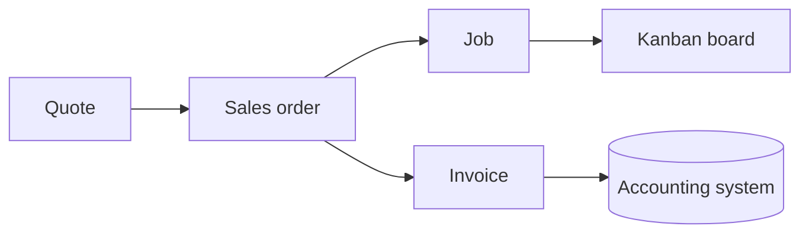

# Vision

| | |
|---|---|
| **Status** | Draft |
| **Owner** | Stuart Meeks |
| **Last updated** | 2026-10-12 |

## The problem

Small sign and print shops run their whole business through a handful of documents: a quote, an order, a job ticket and an invoice. The software available to them is either:

- **Generic** job or accounting tools that don't understand how signage is priced or produced, or
- **Specialist** shop management platforms that are expensive per seat, getting more expensive, cluttered with features a small shop never uses, and outside the shop's control when something breaks (customer emails landing in spam is a common and costly example).

A shop with four people on the floor should not be paying enterprise prices for software it fights with every day.

## What Signboard is

An open-source, hosted application (which a business can also run itself) that runs a sign or print shop's core workflow. It is built for sign and print first, and works for any made-to-order business, such as an embroiderer, engraver or fabricator, because its model is trade-neutral and the trade lives in configuration ([ADR 0049](engineering/decisions/0049-scope-made-to-order-businesses.md)):

## Goals

1. **Quote accurately and quickly**, using the pricing methods sign shops actually use (measured area and length, machine time, quantity breaks, labour), which suit other made-to-order work too, including mixed methods on a single line.
2. **Give the shop floor a clear, live view** of every job and where it is.
3. **Get customer email to the inbox**: quotes, proofs and invoices that arrive reliably and look professional.
4. **Keep the books in sync** with the shop's accounting system without double entry.
5. **Be owned by the shop**: open source, hosted or self-hosted, with its data exportable at any time.
6. **Stay small**: do the core workflow very well rather than everything adequately.

## Non-goals (for v1)

- Inventory and stock control
- Purchasing and supplier management
- A full CRM (sales pipelines, campaigns)
- Payroll, timesheets or HR
- An online storefront

These may come later, but only when a real business asks for them. The same goes for features for other trades: none is built until a real business in that trade asks.

## Personas

| Persona | Who they are | What they need most |
|---|---|---|
| **Owner** | Runs the business; often also sells, designs and quotes | Fast, accurate quotes; visibility of what's due and what's been paid |
| **Designer** | Produces artwork, drawings and proofs | Clear briefs; a simple proof and approval loop |
| **Production staff** | Makes the work: in a sign shop, prints, laminates, cuts, routes and fabricates | Knowing what to work on next, with every spec they need on the job |
| **Installer** | Fits signs and wraps on site (field staff, in Signboard's roles) | Site address, contact, date, and exactly what's being installed |
| **Customer** | Businesses, organisations and individuals buying signage | Professional quotes and proofs that are easy to approve |
| **Platform operator** | Member of the operations account; runs the hosted Signboard service | Safe upgrades, monitoring, backups and tenant isolation, without seeing businesses' data unless they join a business account to help |
| **Self-hosting admin** | Runs Signboard on a business's own server instead of using the hosted service | Simple deployment, backups and upgrades |

## Design partner

Signboard is being built first for a real, working sign and print shop in regional New South Wales: four people on the floor, offering design, large-format print, laminating, laser cutting, CNC routing, vehicle wraps, illuminated signage, engraving and installation. Requirements are validated against how that shop actually works. Everything specific to that shop, or to the sign trade, lives in configuration, never in code, and becomes the sign and print starter pack.

## Principles

### Plan the foundations, then deliver in phases

Signboard is documented before it is built, and that is deliberate.

Some parts of a system are cheap to change later: screens, wording, reports. Others are very expensive to change once a shop has months of real data in them: the data model, the pricing engine, and the lifecycle that connects a quote to a sales order to a job to an invoice. Those foundations are designed in full, up front.

The right picture is a house, not a skateboard that slowly becomes a car. You pour the full foundations and run the plumbing and wiring for every room before you start. Then you fit out one room at a time, and move into it before the rest are finished.

In practice:

- **Design documents cover the whole system** from the start: the complete data model, every state machine, all integration boundaries.
- **PRDs are complete, but delivered in phases** in dependency order, with each phase put in front of a real shop as soon as it is usable.
- **The new system runs alongside the old one** until it has handled a full month of real work.

### Configuration over customisation

Pricing rules, production stages, tax settings, branding and email templates are configuration. A new business should be able to adopt Signboard without changing a line of code.

### API first

There is one API, used by the web app, by customers and by integrations alike. What each actor can see is decided by authorisation, not by which API they call ([ADR 0010](engineering/decisions/0010-api-first.md)).

### Documentation is king, testing is queen

Nothing is built until the problem and the proposed implementation are written down and approved ([ADR 0011](engineering/decisions/0011-documentation-first.md)). Every acceptance criterion is covered by an automated test ([ADR 0012](engineering/decisions/0012-testing.md)).

### Work in the open

Plans, decisions, bugs and mistakes are all public ([ADR 0013](engineering/decisions/0013-work-in-the-open.md)).

### Boring technology

Signboard will be maintained in evenings and weekends. Every technical choice should favour tools that are stable, well documented and easy to pick up again after a fortnight away.

### The shop owns its data

Everything can be exported in open formats. There is no lock-in, including to Signboard itself.

## Delivery phases

| Phase | Scope | Usable outcome |
|---|---|---|
| 1 | Foundations: users, customers, catalogue, pricing engine | Pricing can be tested against real past jobs |
| 2 | Quotes, PDFs, customer email, customer portal for quote and proof approval | The shop quotes from Signboard while still running its old system |
| 3 | Sales orders, jobs, kanban | Production runs from the board |
| 4 | Invoices and accounting sync | Billing runs from Signboard |
| 5 | Migration and cut-over | The old system is switched off |
